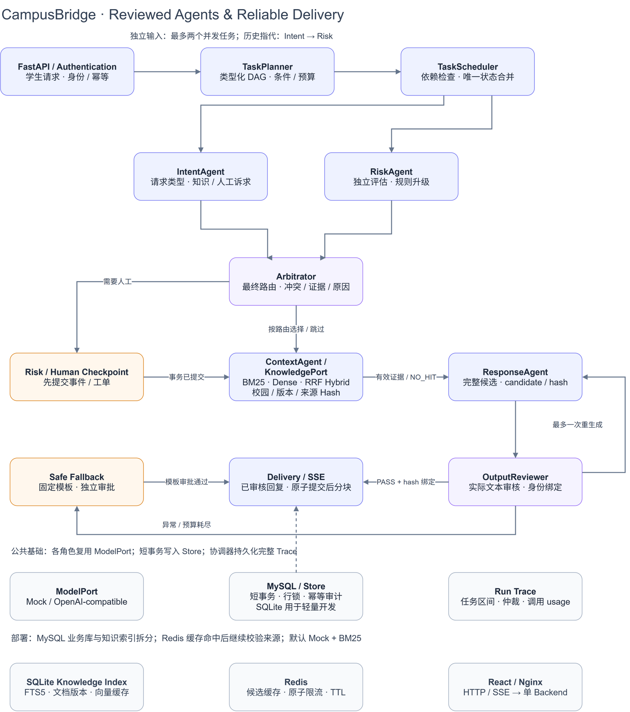

# CampusBridge

Stage D1 adds optional MySQL 8 business persistence, Alembic migrations, row-level concurrency controls and a separate SQLite knowledge index. SQLite + MockModel remains available locally. [Database migration and operational boundaries](docs/STAGE_D1_DATABASE.md).

Stage D3 provides `docker compose up --build -d`: MySQL 8, Redis, one backend worker and a production frontend at `http://127.0.0.1:8080`. MockModel needs no API key; dedicated bootstrap/migration jobs and named volumes manage credentials, schema and knowledge persistence. [Deployment guide](docs/STAGE_D3_COMPOSE.md) · [Actual acceptance](experiments/stage-d3/20261015-v1/HANDOFF.md).

Optional CPU Dense and RRF Hybrid retrieval are available through the existing KnowledgePort. On 72 frozen queries, BM25 / Dense / Hybrid chunk Recall@3 is 76.79% / 91.07% / 89.29%; on 32 held-out queries it is 83.33% / 85.42% / 89.58%. BM25 remains the dependency-free default. [Implementation and reproduction](docs/RAG_STAGE_B.md) · [Complete retrieval results](experiments/rag/stage-b/20261015-v1/analysis/COMPARISON.md).

[](https://github.com/chen0206a/CampusBridge-Agent/actions/workflows/ci.yml)

**Original student-support agents with dynamic planning, evidence arbitration, reviewed delivery, and human follow-up.** [中文](README.md)

CampusBridge connects student conversations, cited campus knowledge, and a counselor case workspace. The backend uses Python/FastAPI/Pydantic/SQLAlchemy, MySQL business persistence, an independent SQLite knowledge index and Redis; the web client uses React/Vite/TypeScript. SQLite-only development remains available. Original code and assets are MIT licensed. [Release Candidate acceptance](RELEASE_CANDIDATE_HANDOFF.md) · [Release Notes](docs/RELEASE_NOTES_RC.md)

## Architecture



- **Typed task DAG:** TaskPlanner selects an execution path using the request, history and structured Intent/Risk outputs. The scheduler enforces dependencies, finite budgets and cancellation.
- **Bounded concurrency:** independent Intent/Risk tasks run concurrently with separate request contexts; a coordinator merges their results. History-dependent requests retain a dependency. Database Sessions are short and are never shared across concurrent agents.
- **Arbitration:** high-risk priority, explicit human-support requests at LOW severity, partial failures and irrelevant evidence are resolved by server policies with traceable evidence hashes.
- **Reviewed delivery:** complete candidates are reviewed and bound by candidate/content/citation hashes. Rejected text is never streamed. One regeneration is allowed before a fixed safe fallback.
- **Grounded RAG:** original campus documents, versioned imports, SQLite FTS5/BM25, deterministic citation allowlists and inspectable source details.
- **Human workflow:** persist attention events/cases before generation; enforce OPEN → CLAIMED → IN_PROGRESS → CLOSED with authorization, optimistic versions, idempotency and audit history.


[More screenshots](docs/PROJECT_SHOWCASE.md) · [Sequence and execution examples](docs/EXECUTION_EXAMPLES.md) · [Demo script](docs/DEMO_SCRIPT.md)

## Run without an API key

Clone first:

```bash
git clone https://github.com/chen0206a/CampusBridge-Agent.git
cd CampusBridge-Agent
```

Recommended: `docker compose up --build -d`, then visit http://127.0.0.1:8080/. No local Python, Node, database or API key is required. Compose runs one backend, MySQL, Redis and the frontend with private named volumes and a dedicated migration job. `docker compose down` preserves data. [Deployment guide](docs/STAGE_D3_COMPOSE.md).

For lightweight SQLite development, use Python 3.12+ and Node 22.12+:

From the repository root, on Linux/macOS:

```bash
python3 -m venv .venv
.venv/bin/python -m pip install -r requirements.lock
.venv/bin/python -m pip install -e . --no-deps
(cd frontend && npm ci && npm run build)
CAMPUSBRIDGE_MODEL_PROVIDER=mock CAMPUSBRIDGE_ORCHESTRATION=dynamic \
  .venv/bin/python scripts/web_backend.py --port 8015
```

Windows PowerShell equivalents are in the [main README](README.md). Visit http://127.0.0.1:8015/ or http://127.0.0.1:8015/docs. The built client and API share one origin.

Demo users: `student_lan`, `student_he`, `counselor_yu`; public fictional demo password: `CampusDemo-2026!`. MockModel works offline. The application reads process environment variables; `.env.example` is a configuration reference.

## Real-provider experiments

| Stage | Fixed 30 | Natural 20 | Controlled 10 | Boundary 12 |
|---|---:|---:|---:|---:|
| Stage 4 | 26/30 | 17/20 | 9/10 | — |
| Stage 5 | 28/30 | 18/20 | 10/10 | 10/12 |
| Stage 6 Sequential | 28/30 | 18/20 | 10/10 | 10/12 |
| Stage 6 Dynamic | 28/30 | 18/20 | 10/10 | 12/12 |

The Stage 6 paired runs use the same role Prompts, original cases/gold, model alias, generation and checks: thinking disabled, temperature 0, output limit 1024.

| Metric | Sequential | Dynamic |
|---|---:|---:|
| Fixed-set success | 28/30 | 28/30 |
| Boundary success | 10/12 | 12/12 |
| Agent task executions, fixed set | 176 | 150 |
| P50 case latency, fixed set | 4.32s | 3.43s |
| Model requests, fixed set | 125 | 126 |
| Boundary fallback cases | 2 | 0 |

Two unchanged historical references expect MODERATE severity; current outputs are LOW plus an explicit human-support need and create the correct case. They remain risk-label failures in the published scores. Dynamic resolves unrelated evidence and forged user source markers; a missing citation required one additional model request. Latency is a single paired measurement of the whole orchestration policy.

[Full results and reproduction](docs/EXPERIMENTS.md) · [Unchanged archived result bytes and hashes](experiments/README.md)

## Tests and evaluation

In the installed Python environment:

```bash
python -m pytest -q
python scripts/showcase_demo.py --output runs/demo-001
python scripts/http_smoke.py --output runs/http-001.json
python scripts/verify_archive.py
(cd frontend && npm test && npm run build)
```

D5 passed **349 backend tests**, with 21 opt-in cases covered separately by a 39-test real MySQL/Redis suite; Linux container tests passed 55 and frontend tests passed 27. Type checking and production builds passed. [Current RC clean-clone results](RELEASE_CANDIDATE_HANDOFF.md). CI covers Ubuntu/Windows on Python 3.12/3.13 and Node 22 frontend tests/builds, using MockModel without a model key.

## Single-backend performance evidence

Unchanged Mock Locust workloads covered 10/30/50/100 virtual users. At 100 VU, the same-day unoptimized/optimized pair improved 15.08→18.14 RPS, P95 15.29→12.99s and P99 16.62→13.79s. The optimized run completed 3,143 HTTP requests without failures or timeouts. D5 removed redundant coordinator state reads and batched synchronous arbitration audit metadata; review and risk checkpoints retain their transaction boundaries. Historical D4 results, resource curves and all paired raw measurements remain separate. [Profiling and reproduction](docs/STAGE_D5_PERFORMANCE.md) · [Full results](experiments/stage-d5/20261016-v1/HANDOFF.md).

Optional real providers use server-side `CAMPUSBRIDGE_ENDPOINT`, `CAMPUSBRIDGE_MODEL`, `CAMPUSBRIDGE_API_KEY` and `CAMPUSBRIDGE_MODEL_PROVIDER=openai-compatible`. The frontend receives no model credential. New evaluations freeze a new packet for the current checkout and enforce an explicit cost budget.

## Offline retrieval baseline (Stage A)

[RAG evaluation](docs/RAG_STAGE_A.md) adds 72 fixed synthetic development queries and an isolated 16-document corpus. Current BM25 chunk Recall@1/3/5 is 60.71%/76.79%/76.79%; MRR is 0.7143. Raw results, source bindings and configuration hashes are retained with zero model calls. Production retrieval is unchanged; 228 backend tests pass in this local branch.

## License and scope

[MIT](LICENSE) for original source, Prompts, synthetic knowledge/data and assets. [Provenance](docs/PROVENANCE.md) · [Dependency notices](THIRD_PARTY_NOTICES.md) · [Security](SECURITY.md) · [Contributing](CONTRIBUTING.md).

The system supports student conversations and human follow-up. Professional staff own diagnosis and real intervention. All public demonstration data is fictional.

## Optional Redis retrieval cache and rate limiting

Stage D2 adds candidate caching for BM25/Dense/Hybrid and atomic login/message limits. Cache hits revalidate campus, active document revision and source hashes against the knowledge store. Cache outages bypass Redis; enabled authentication/message limits fail closed with HTTP 503. Both features are disabled by default, so SQLite + MockModel works without redis-py. See [design and commands](docs/STAGE_D2_REDIS.md) and [real Redis acceptance](experiments/stage-d2/20261015-v1/HANDOFF.md). Business execution retains D1's single-runtime guard.
