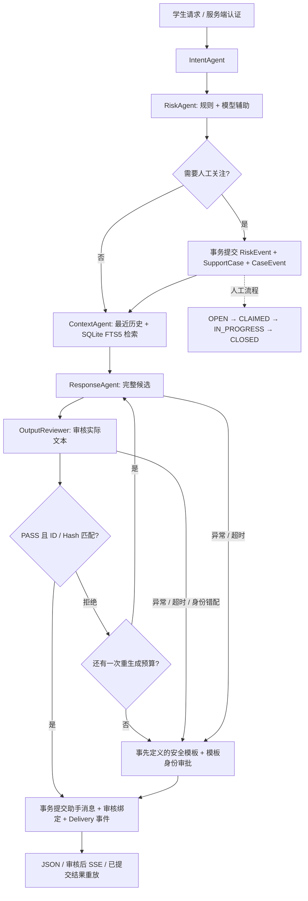

# CampusBridge 架构

Stage 6 在以下业务链上增加轻量 TaskPlanner、TaskScheduler 和 Arbitrator，支持 `sequential` / `dynamic`。动态流程、任务依赖、并发一致性与预算详见 [动态编排说明](STAGE6_ORCHESTRATION.md)；[可编辑架构图](assets/campusbridge-stage6.drawio) 展示当前实现。下方顺序流程作为保留的基线，数据库和最终审核交付继续复用。

## 分层

API 层校验身份、DTO、scope 和传输。Runtime 掌握协作顺序、路由、预算与最终交付决定。Agent 用明确输入输出契约调用统一 ModelPort；ContextAgent 使用 KnowledgePort。Store 用短 SQLAlchemy Session 管理 SQLite 事务和业务状态。模型 await 期间不持有数据库事务。

## Agent 契约

| 角色 | 输入 | 产物 | 模型调用 |
|---|---|---|---|
| IntentAgent | 当前消息、有限历史 | IntentOutput：GENERAL/SUPPORT/CAMPUS_SERVICE/URGENT、知识需求 | ModelPort |
| RiskAgent | 当前消息、历史、可选 intent（指代依赖时提供） | RiskOutput：等级、人工关注、限定 reason codes | ModelPort + 代码规则合并 |
| ContextAgent | 当前消息、历史、intent/risk、campus | ContextOutput：route、history、带 revision 的知识卡 | KnowledgePort，可跳过 |
| ResponseAgent | 上下文、risk、attempt、feedback | 完整文本的 CandidateOutput：ID/Hash/来源/尝试号 | ModelPort |
| OutputReviewer | 实际 candidate、risk | ReviewOutput：candidate_id/content_hash/verdict | 规则 + ModelPort |
| Delivery | 当前候选与审批 | 助手 Message 和 DeliveryOutput | 无 |

每次 Agent 执行产生 AgentResult，含输入摘要、类型化 Artifact、SUCCESS/DEGRADED/FAILED、耗时与失败代码，再保存为 Event/RunEvent。Trace 展示这些工程产物，不记录模型私有推理链。

## 路由与预算

- need_human → HUMAN_SUPPORT，先提交风险事件/工单，再准备上下文。
- 需要校园资料 → KNOWLEDGE_SUPPORT，由 KnowledgePort 检索版本化文档并携带来源。
- 其余 → CONVERSATION，普通聊天也保留最近 12 条历史消息。
- 同一对话在单进程内串行，后续轮次只读已完成前序轮次，避免把未来输入混入历史。
- 总模型调用默认最多 6 次：Intent、Risk、Response、Review，加最多一次 Response/Review 重试。
- Mock 默认单次 2 秒、整轮 15 秒；环境变量选择真实 Provider 后默认单次 20 秒、整轮 90 秒；知识查询 1 秒。输入输出长度有 schema 上限。

超时后取消子任务，迟到结果不会写库或交付。端口实现应响应取消；未来阻塞 SDK 使用可终止进程边界。客户端响应取消只停止消费，应用保有 runtime job，可按 run_id 查询已提交结果。服务停止时处理当前任务；进程重启将历史非终态 run 标记 FAILED/SERVER_RESTARTED，已有工单保持。

## 最终文本审核

先完整生成，再审核实际文本。ReviewOutput 必须绑定同一 candidate_id、原文本 UTF-8 Hash 和引用元数据 Hash；模型输出不能自行取得 TEMPLATE 权限。PASS 才能原子写入助手消息、接受状态和 Delivery 事件。

RETRY 最多触发一次重新生成；REJECT、重复拒审、异常、超时、错配或预算不足使用固定安全模板。模板不填充用户输入，其审批记录同样绑定 ID/Hash。SSE、单 run 查询、对话历史三个正文入口均校验审批。学生 Trace 隐去所有候选正文；辅导员在同校园 scope 内可查看完整审核产物。

当前确定性规则覆盖明确危险表达触发、诊断断言、隔离求助、常见联系方式/凭据、后台风险标签和高风险当前安全引导。风险模型无法降低明确规则触发的 HIGH；风险评估不可用时使用 UNKNOWN 并转人工确认。工单用于支持跟进，不由模型作疾病诊断或自动关闭。

## 数据模型与事务

| 模型 | 关系/职责 |
|---|---|
| Account / Student / LoginToken | 角色、校园范围、虚构学生资料、哈希 token |
| Conversation / Message | 学生所有权、按顺序的用户与已审核助手消息 |
| AgentRun / RunEvent | 请求幂等、状态、当前候选/审批、调用量和完整工程 Trace |
| ModelCall | 每次模型调用状态、耗时、已报告 usage、输出校验与安全错误代码 |
| KnowledgeDocument / KnowledgeChunk / knowledge_fts | 文档版本、原文坐标、Hash、许可与同事务词面索引 |
| RiskEvent / SupportCase | 一次 run 的风险事实与对应人工事项，唯一关联 |
| CaseEvent | CREATE/CLAIM/PROCESS/CLOSE、服务端 actor、意见、版本和操作键 |

风险事件、工单及创建审计同事务提交，生成在其后。故障注入测试证明该事务整体回滚时不启动生成；生成故障时已提交工单仍可查询和认领。

工单操作使用 SQLite BEGIN IMMEDIATE 串行写入，验证 campus、角色、owner、expected_version、状态和 note。相同 case/key/actor/payload 重放原操作结果，其他复用返回冲突。并发认领仅一名成功，所有状态和意见写入审计事件。

## 接口扩展

ModelPort 统一接受任务名、system/user 消息、输出长度与采样参数，返回内容和 usage。已实现的 OpenAI-compatible adapter 负责请求格式、严格 envelope、错误/timeout、usage 和取消；各 Agent 继续负责角色输出 schema、路由、审核与业务事务。

KnowledgePort 返回 source_id/title/text/revision 和文档 ID、坐标、Hash、分数。默认 SQLite FTS5/BM25，使用 8 份原创虚构校园资料；保留 MVP DemoKnowledge 适配器供旧回归使用。来源标记由代码校验，引用绑定参与最终审批。详情见 [模型、RAG 与评测](STAGE2_MODEL_RAG_EVAL.md)。

本轮保持单进程 SQLite。生产账号、保留期/审计导出、数据库迁移、多实例任务认领和通知派发在后续独立切片实现。
