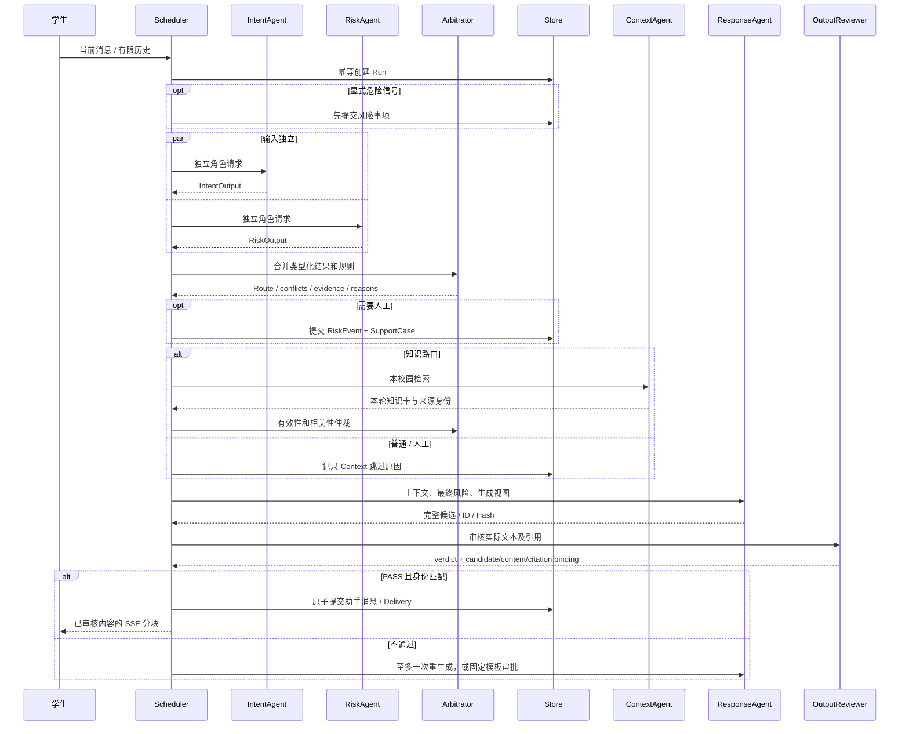

# Sequence、ExecutionPlan 与 Trace

## 一轮动态协作



历史指代依赖会把上述并行分析改为Intent→Risk。独立Risk更早返回人工需求时，协调器立即提交检查点；模型请求通过局部call_id关联，结果合并和业务写入由单一协调器完成。

## ExecutionPlan

原始真实smoke中的可读计划：[ordinary](examples/ordinary-plan.json)、[RAG](examples/rag-plan.json)、[LOW人工支持](examples/human-plan.json)、[高风险/知识冲突](examples/risk-conflict-plan.json)。每个文件记录原始公共artifact路径和SHA。

```json
{
  "task_id": "context",
  "kind": "agent",
  "agent": "ContextAgent",
  "enabled": false,
  "reason": "HUMAN_PRIORITY",
  "status": "SKIPPED"
}
```

此片段展示高风险路径中的真实任务选择。完整计划还包含early-attention、risk-checkpoint、分析仲裁、证据仲裁及Response/Review/Delivery依赖。普通任务默认最多16次执行，模型调用6次；安全事务/模板/交付有固定有限路径。

## 真实冲突仲裁

`cb6-s04`中Intent为URGENT且needs_knowledge=true，Risk为HIGH且needs_human_support=true。仲裁记录 `KNOWLEDGE_REQUEST_SUPERSEDED_BY_HIGH_RISK`，策略HIGH_RISK_FIRST，最终HUMAN_SUPPORT；Context因HUMAN_PRIORITY跳过。风险事项先提交，完整候选审核PASS后交付。

普通意图与HIGH评估直接不一致的指定Mock对照保存在 [controlled mock trace](../experiments/archive/stage6/20261013-dynamic-v1/trace-examples/controlled-mock-disagreement.json)。它是工程复现，不混入真实模型结果。

## Trace读取与验证

同校园辅导员调用GET `/api/runs/{run_id}/trace`可看plan/task_event/arbitration和原始Agent产物；学生看到所属业务状态与已审核消息。任务的单调时钟区间用于核实并发，不从事件列表顺序推断。

计划检查验证DAG、依赖允许状态、实际起止顺序、最终任务状态及candidate/hash审批；路由/工单正确性由原始用例gold分别检查。[原始Trace](../experiments/archive/stage6/20261013-dynamic-v1/real-dynamic-smoke4/cb6-s04.json)
