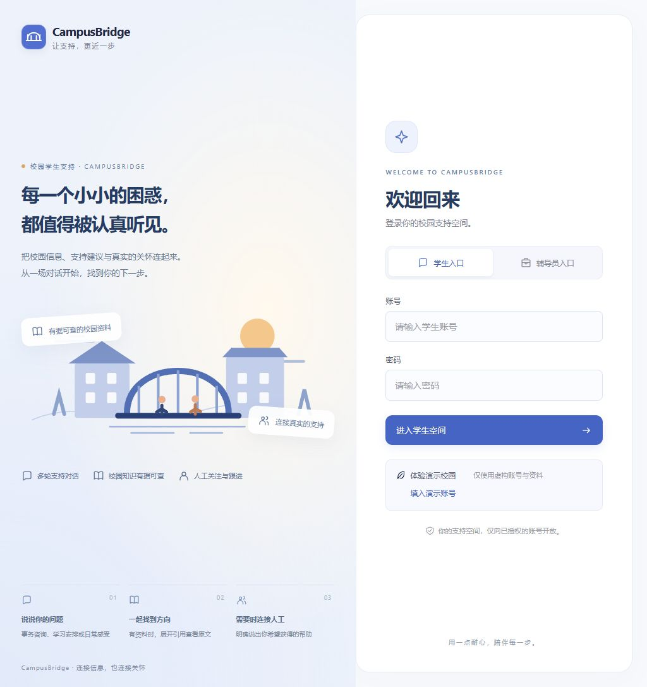
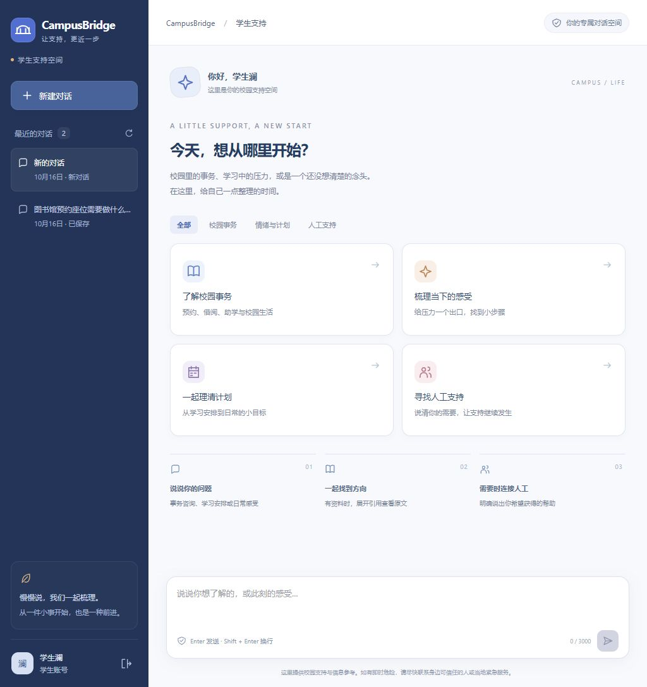
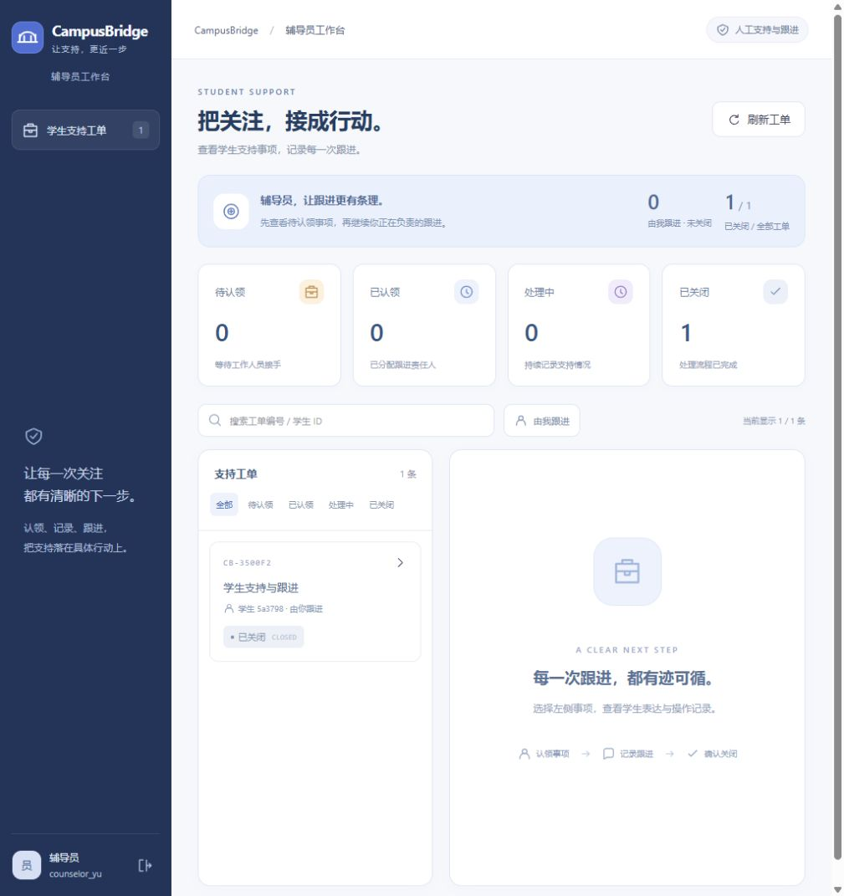

# 前端体验更新 v1

2026-10-16 · 分支 `design/frontend-refresh-v1` · 基于发布后 main `7b977bd`。

## 页面与交互

- 登录：原创 SVG 校园桥梁插画、信息浮签、三步支持说明和更清晰的双身份入口。
- 学生：深靛蓝导航、四类提问卡片、话题筛选、会话数量、输入字数和独立消息层次。
- 宽屏资料区：从已保存回复的 citations 按 source_id 去重，汇总资料、版本并打开原有授权详情接口；切换会话加载期间清空展示。窄屏仍可通过回复内引用查看资料。
- 辅导员：服务端当前工单统计、本人未关闭事项、已关闭/列表数量、工单编号和学生 ID 搜索、“由我跟进”、组合状态筛选及重置入口。
- 工单详情：更明确的进度、学生表达、处理意见与操作历史层次。仍使用原版本号、幂等键与服务端身份校验。

配色为深靛蓝、雾蓝和暖白，以琥珀、浅紫、玫瑰色区分入口和状态。插画和图标由本工程 SVG 基元绘制，无新图片服务、字体服务或依赖。

## 自动化结果

| 检查 | 结果 |
| --- | --- |
| `npm --prefix frontend test -- --reporter=dot` | 31 passed，0 failed |
| `npm --prefix frontend run build` | TypeScript 检查与 Vite 生产构建通过 |
| `python -X utf8 -m pytest tests/test_web_api.py tests/test_api.py tests/test_runtime.py tests/test_stage5.py -q` | 73 passed，1 条第三方 TestClient 弃用提示 |

新增 4 项交互测试：话题筛选不提交请求、引用去重与授权详情、搜索/负责人组合筛选、空结果重置。原 SSE 测试将引用断言限定到对话区域，保留原有流式/恢复断言；右侧新增引用入口由独立用例覆盖。

## 浏览器验收

在独立 SQLite 演示数据库上运行 MockModel 与 dynamic 编排，使用真实 HTTP API 和 fetch SSE：

1. 学生登录，校园资料问答完成，点击来源查看原文、版本和 MIT 署名。
2. 历史对话恢复后，宽屏引用汇总仍可查询当前对话资料。
3. 人工支持入口创建事项；切换辅导员，认领、保存处理记录、关闭，最终 CLOSED、版本 3、4 条操作记录。
4. 工单搜索无匹配时显示空结果，支持清空和重置。
5. 390×844 iframe 中验证登录、对话和侧栏展开；修正主题样式对登录单列布局的覆盖。
6. 1360×900 iframe 中检查真实三栏布局。`fit=1` 只缩放验收视图，不改应用布局或数据。

演示数据均为虚构。没有调用真实模型；原 Agent、Prompt、API、工单策略及历史实验不变。

## 页面截图

截图来自本地浏览器真实页面。宽屏辅助图来自按窗口缩放的验收 iframe；历史展示图保留。

## 运行

沿用 [前端运行说明](../frontend/README.md)，启动 Mock 后端与 Vite。浏览器访问 `http://127.0.0.1:5173/`。

本轮修改集中于 App、StudentWorkspace、CounselorWorkspace、SupportGuide、图标、独立 refresh.css 和交互测试。运行时与 API 没有代码变更；未增加依赖，未修改发布标签，也未自动推送 GitHub。
