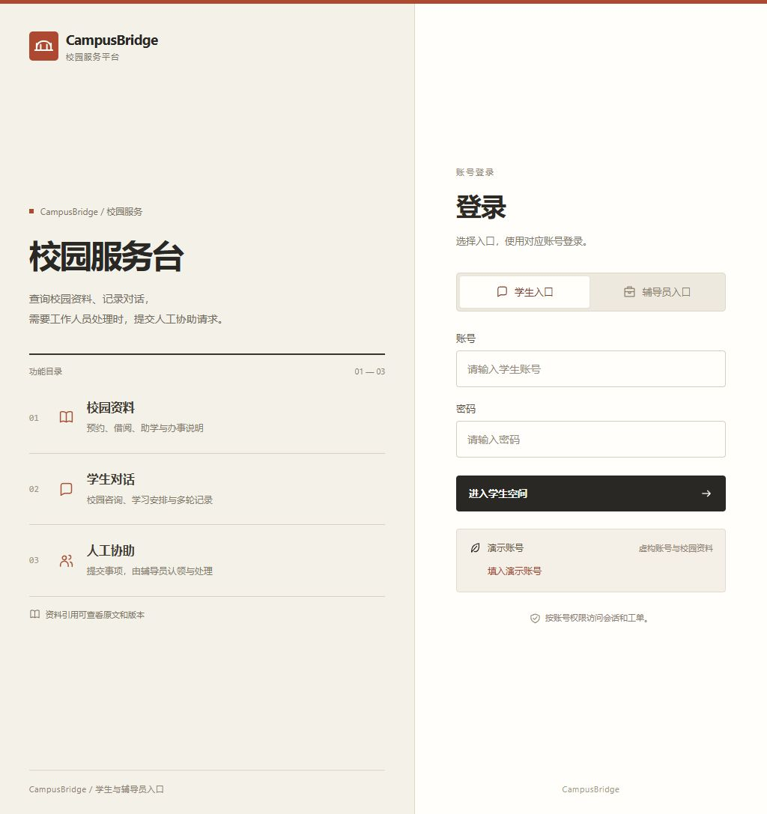
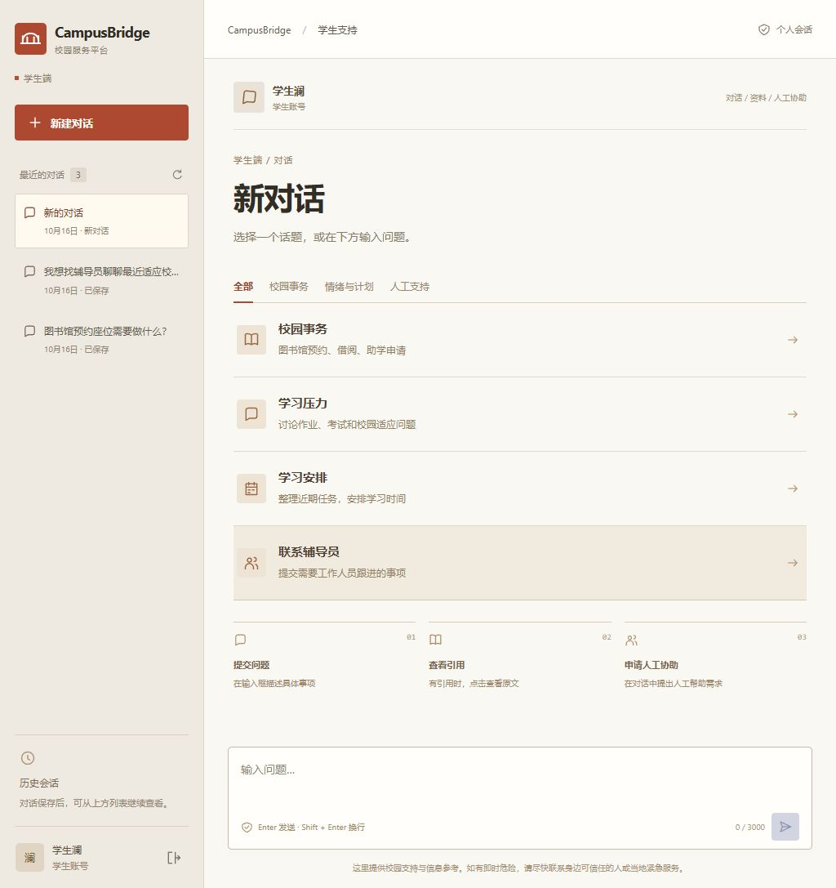
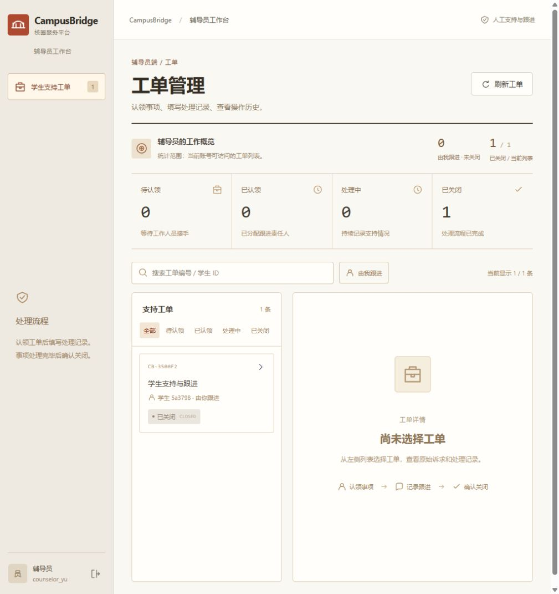

# 前端样式与文案 v2

2026-10-16 · `design/frontend-editorial-v2`。

## 调整

- 米白背景、炭黑标题、砖红操作入口，替换深蓝侧栏与彩色卡片。
- 浅色导航、列表式话题入口、细分隔线和小圆角，减少阴影。
- 登录页改为功能目录：校园资料、学生对话、人工协助。
- 学生页标题为“新对话”，辅导员页标题为“工单管理”。
- 品牌副标题为“校园服务平台”；资料区说明引用原文、版本和查看方式。
- 提示文案描述操作或状态，删除宣传语及无业务含义的英文标语。

话题筛选、历史恢复、来源详情、工单搜索和处理操作沿用原实现。修改范围为前端 JSX、样式、对应可访问名称的测试定位及本说明；未修改后端、Prompt、评测或数据。

## 验证

- 前端：31 passed，0 failed。
- TypeScript 类型检查、Vite 生产构建通过。
- 本地 Mock 浏览器验收：学生/辅导员登录、校园问答 SSE、资料引用展示、历史工单及四条操作记录查看。
- 第一版截图与说明保留；新版截图单独存放。

```powershell
npm --prefix frontend test -- --reporter=dot
npm --prefix frontend run build
```

本地访问 `http://127.0.0.1:5173/`。未自动推送 GitHub。

## 截图






