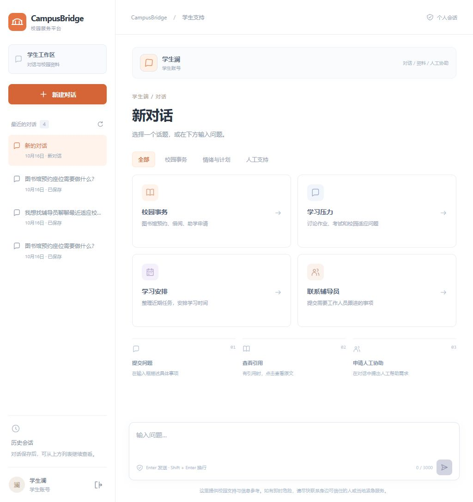
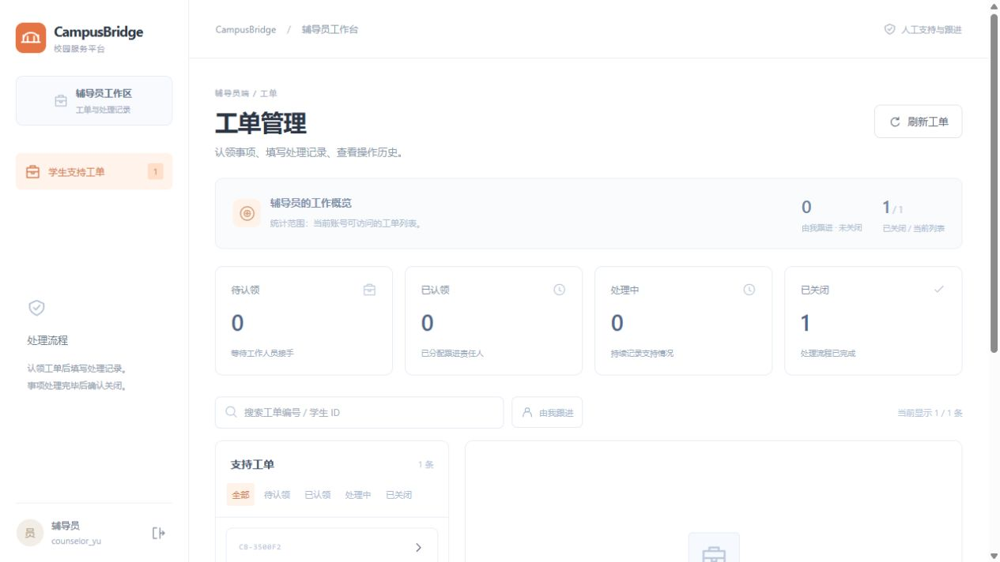

# 白底工作区 v3

2026-10-16 · 分支 `design/frontend-daybreak-v3`。

## 样式

以用户自有的 [Daily AI News Agent](https://github.com/chen0206a/daily-ai-news-agent) 页面为视觉参考，调整 CampusBridge 的按钮、边框、卡片和留白。

- 页面、导航和主内容底色为白色。
- 主按钮使用橙色，次按钮使用白底细边框，选中项使用浅橙底。
- 工作区、统计、来源详情使用浅灰边框和 8–12px 圆角。
- 学生话题采用两列卡片，辅导员工单保持列表与详情布局。
- 侧栏标明学生/辅导员工作区，保留 v2 的功能性标题和操作说明。

本轮仅修改 CampusBridge 前端样式和角色标识。参考项目保持原样；没有导入新闻功能、业务数据或凭据。

## 当前网页范围

| 入口 | 页面功能 |
| --- | --- |
| 学生工作区 | 新建/恢复对话、话题筛选、多轮 SSE、资料引用与原文、人工协助请求 |
| 辅导员工作区 | 工单统计、搜索与筛选、认领、处理记录、关闭、操作历史 |
| API/脚本入口 | Agent Trace 查询、知识导入与固定评测等工程功能 |

学生账号与辅导员账号由服务端鉴权后进入各自页面。网页没有通过角色切换按钮取得其他角色权限；演示时可以在独立标签页分别登录。

## 验证

- 前端 31 passed，0 failed。
- TypeScript 检查与 Vite 生产构建通过。
- 本地浏览器：学生登录、会话恢复、引用展示、新对话，以及辅导员登录和工单列表。
- 历史截图保留，新截图位于 `docs/assets/ui-style-v3/`。

```powershell
npm --prefix frontend test -- --reporter=dot
npm --prefix frontend run build
```

本地预览 `http://127.0.0.1:5173/`。本轮在独立本地分支提交。




