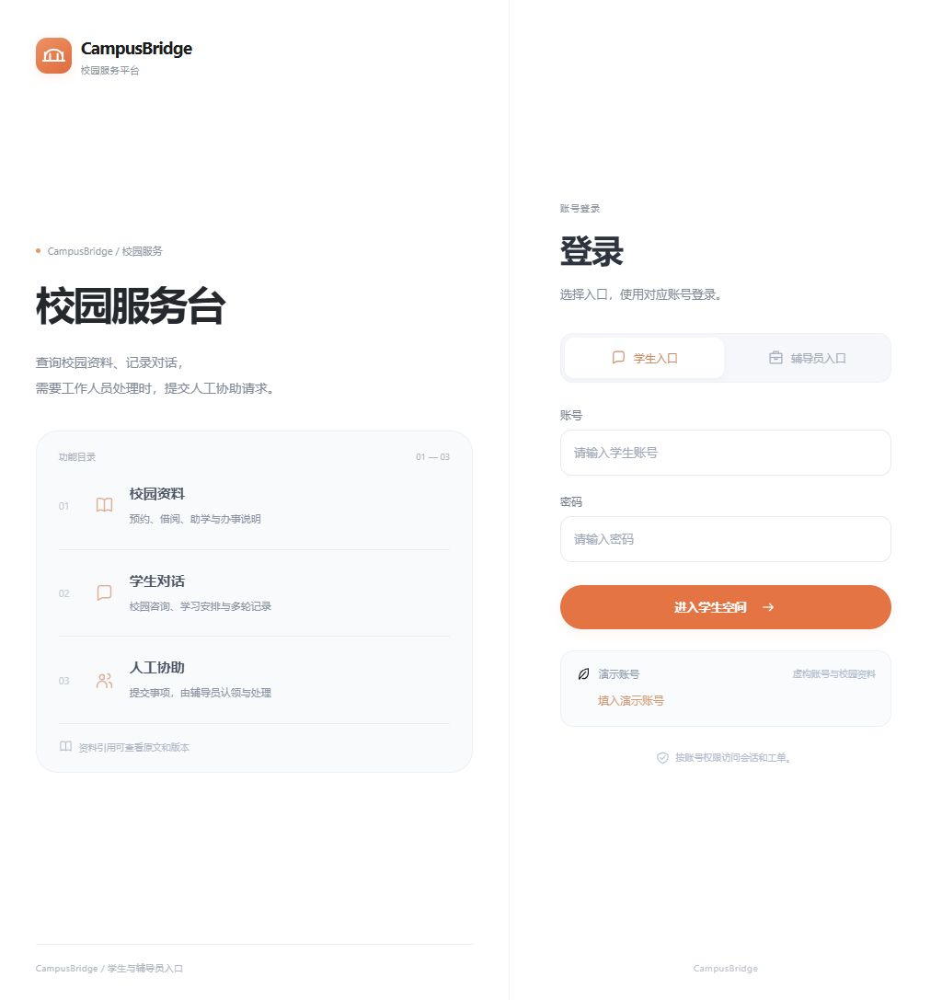
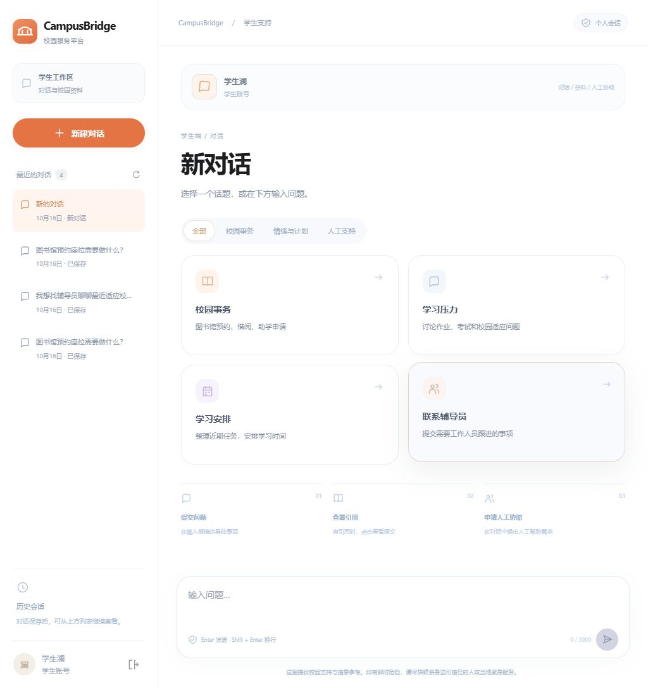
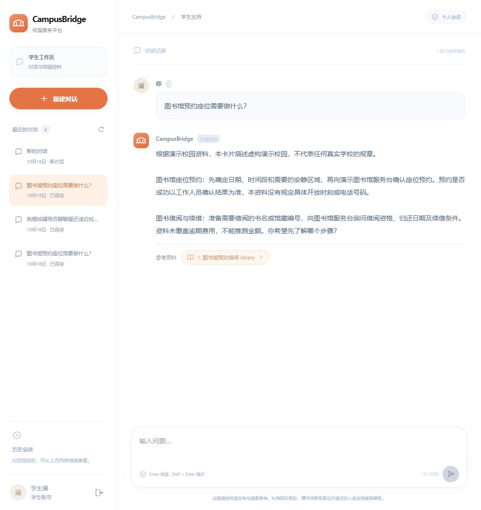
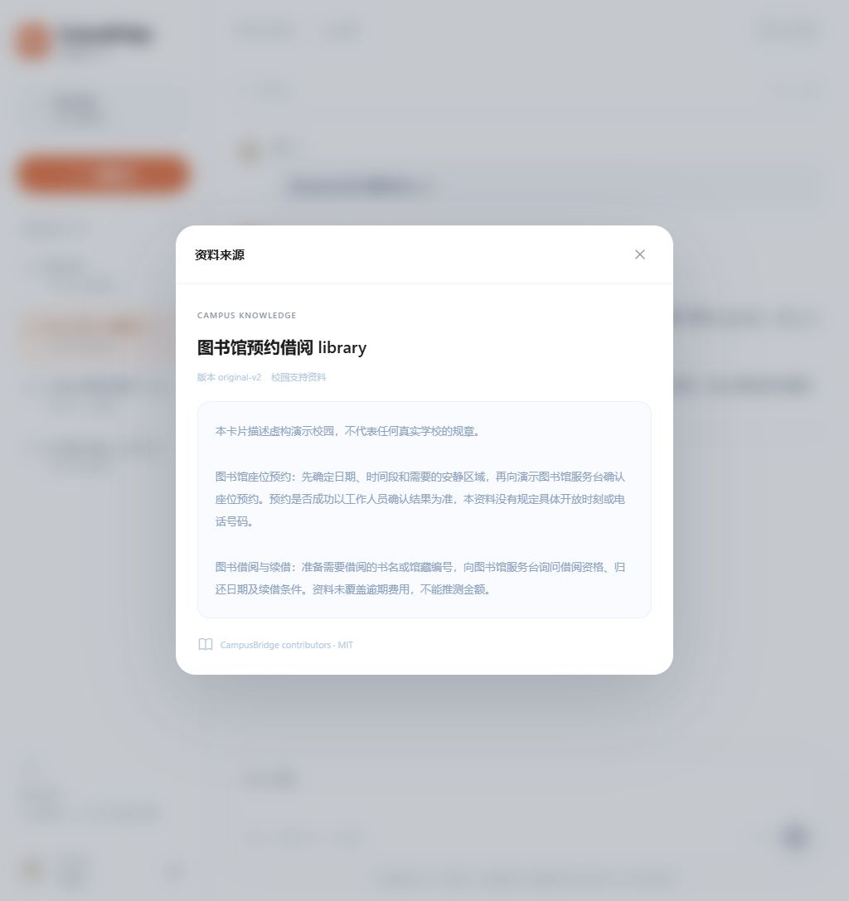
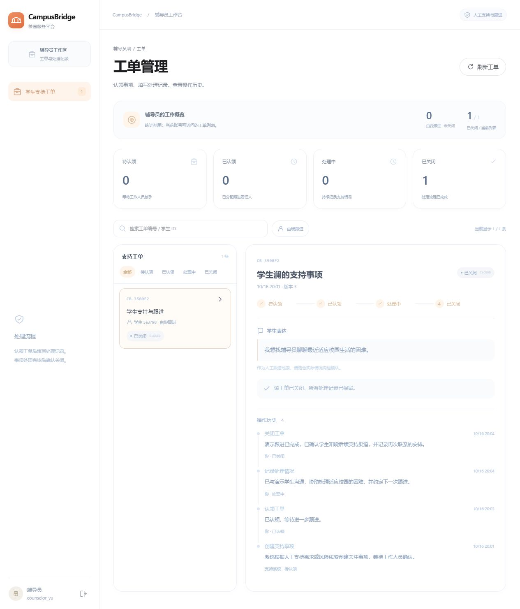

# CampusBridge · 项目展示

原创学生支持Web应用，通过动态多Agent协作把交流、可核对的校园知识和辅导员人工跟进连接起来。主流程与操作都可在本地Mock模式体验。

## 当前界面 · 2026-10-17

白色底面、系统字体、橙色操作按钮和轻微毛玻璃；卡片、按钮、弹窗提供短过渡，并适配减少动态效果设置。

以下均为当前应用的实际浏览器截图，使用虚构演示账号和 MockModel。辅导员工单图为全页截图，包含完整四条操作历史。

[本次改动与验证](FRONTEND_POLISH_20261017.md) · [图片来源与 Hash](assets/showcase-20261017/manifest.json)

## 历史界面记录

## 学生对话

发布准备阶段实际浏览器截图，使用当前MockModel + dynamic编排、虚构学生澜；页面保留来源引用与刷新恢复。

## 辅导员工作台

工作台总览于2026-10-14从当前MockModel + dynamic演示页面重新截取，完整展示工单状态与四条操作历史，采用PNG保存；演示账号和工单内容均为虚构。

## 完整工单流程

以下四张状态详情图保留Stage3浏览器验收原始字节。

| 状态 | 服务端行为 |
|---|---|
| OPEN | 人工事项已独立提交，生成异常仍可查询 |
| CLAIMED | 认领验证身份、校园、owner、版本和幂等键 |
| IN_PROGRESS | 保存工作人员处理意见与审计记录 |
| CLOSED | 关闭依据确认、版本推进与完整操作历史 |

发布准备阶段重新在浏览器走通了上述四种状态，当前窄屏截图另存为 [OPEN](assets/showcase/case-open.jpg)、[CLAIMED](assets/showcase/case-claimed.jpg)、[IN_PROGRESS](assets/showcase/case-in-progress.jpg)、[CLOSED](assets/showcase/case-closed.jpg)。

## 展示方式

学生登录→图书馆问题→来源原文→刷新/继续→人工支持请求→辅导员认领/记录/关闭→四条操作历史→任务图与仲裁Trace→真实实验表。

[2–3分钟逐步讲解](DEMO_SCRIPT.md) · [Sequence/ExecutionPlan/Trace](EXECUTION_EXAMPLES.md) · [实验结果](EXPERIMENTS.md) · [简历介绍](PORTFOLIO.md)

当前发布回归后端203项、前端27项通过。图片来源与Hash见 [asset manifest](assets/showcase/manifest.json)，资产许可见 [ASSETS.md](ASSETS.md)。
